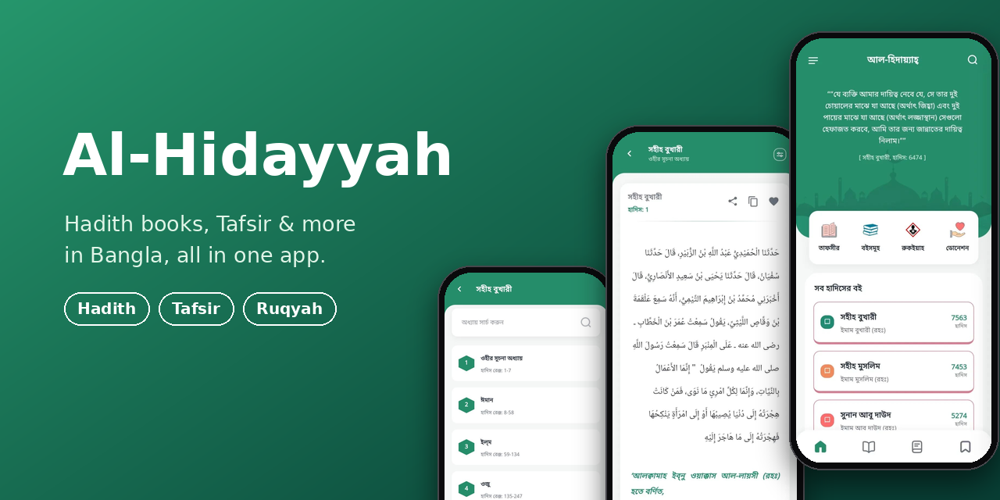
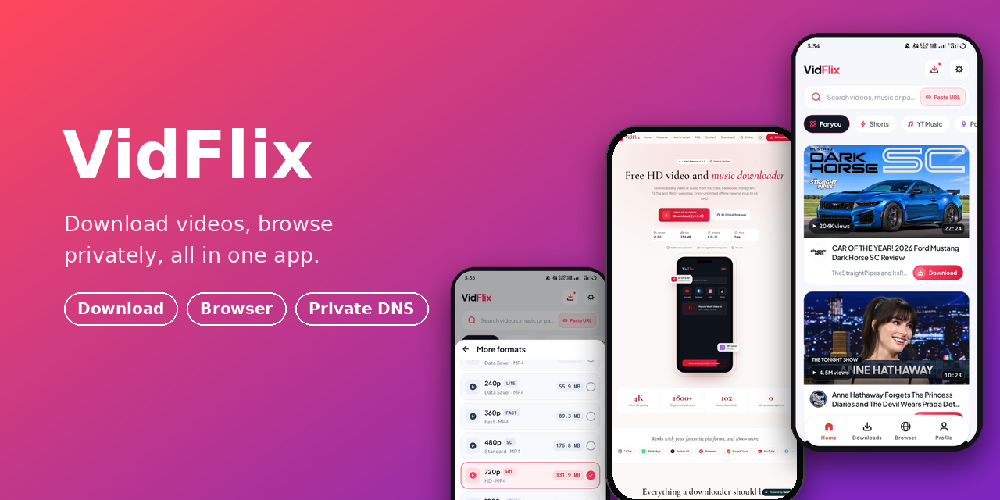

  

  

<h1 align="center">
  
</h1>

<h3 align="center">
  
  
  
</h3>

  <b>Passionate about building modern applications, beautiful interfaces and intelligent digital solutions.</b>

---

## 👨‍💻 About Me

- 🚀 Passionate developer exploring modern technologies
- 📱 Focused on Android application development
- 🌐 Building modern web experiences
- 🤖 Exploring AI & Machine Learning
- 🎨 Interested in UI/UX and creative design
- 💡 Turning ideas into practical digital products
- 🔭 Always learning, experimenting and building

 

---

# 🚀 My Featured Projects

<!-- ==================== PROJECT 01 ==================== -->

<h2 align="center">🕌 Al-Hidayah</h2>

  

  
  
  

  <b>A comprehensive Islamic knowledge application in Bangla.</b>

Al-Hidayah is an Islamic application designed to make authentic Islamic knowledge accessible through a clean, modern and user-friendly experience.

### ✨ Features

- 📖 Hadith collections
- 📚 Islamic books
- 🕌 Tafsir resources
- 🤲 Ruqyah
- 🔖 Bookmarking and saved content
- 🔎 Search functionality
- 🇧🇩 Bengali Islamic content
- 📱 Modern Islamic user interface

---

<!-- ==================== PROJECT 02 ==================== -->

<h2 align="center">🌱 PlantX</h2>

  

  
  
  

  <b>An AI-powered crop disease identification and management system.</b>

PlantX combines mobile technology and machine learning to help users identify plant diseases and explore crop management guidance.

### ✨ Features

- 🌿 AI-powered crop disease identification
- 📸 Leaf image scanning
- 🔬 Disease detection and diagnosis
- 🪴 Crop health information
- 🧪 Fertilizer guidance
- 💧 Spray management suggestions
- 🤖 AI agricultural assistance
- 📱 Mobile-first experience

---

<!-- ==================== PROJECT 03 ==================== -->

<h2 align="center">🎬 VidFlix</h2>

  

  
  
  

  <b>A modern video & music downloader with integrated private browsing features.</b>

VidFlix is an Android media utility featuring media downloading, video quality selection, a built-in browser and privacy-oriented features in one application.

### ✨ Features

- 📥 Video downloading
- 🎵 Music & audio downloads
- 🎞️ Multiple video quality options
- 🌐 Integrated web browser
- 🛡️ Privacy and DNS tools
- 📱 Modern Android UI
- 🔄 APK update system

### 🌐 VidFlix Links

  
  
  

---

<!-- ==================== PROJECT 04 ==================== -->

<h2 align="center">🏡 Elite Estates</h2>

  

  
  
  

  <b>A modern real estate website for discovering premium properties.</b>

Elite Estates showcases a modern property discovery experience with elegant layouts, property listings and premium visual presentation.

### ✨ Features

- 🏠 Property listings
- 🔍 Property discovery
- 💎 Premium property showcase
- 🏢 Modern real estate interface
- 📱 Responsive web design
- ✨ Elegant UI and layouts

  

---

<!-- ==================== PROJECT 05 ==================== -->

<h2 align="center">🍿 FlixBay</h2>

  

  
  
  

  <b>A cinematic movie discovery website with a stylish dark interface.</b>

FlixBay is a movie discovery project designed around a cinematic browsing experience, featuring movie collections, featured content and a modern entertainment interface.

### ✨ Features

- 🎬 Movie discovery
- 🍿 Featured movies
- 🔎 Browse entertainment content
- 🌑 Cinematic dark interface
- 🎨 Modern visual experience
- 📱 Responsive layout

  

---

# 🧰 Tech & Tools

  

  

  

### 💻 Technologies I Work With

  
  
  
  
  
  
  
  
  
  
  

---

# 📈 GitHub Analytics

  
  

  

  

---

# 🌐 Find Me Online

  
  
  
  

---

  

  

  <b>✨ Designed with creativity · Developed with passion · Powered by curiosity ✨</b>

  © Sanjidur Rahman Apu

