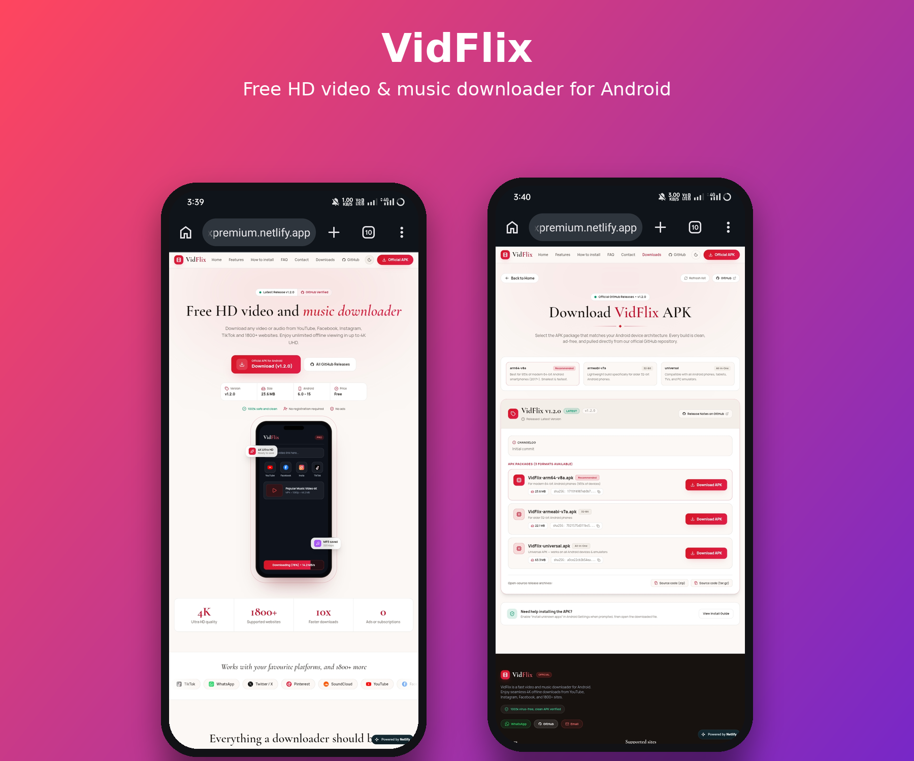
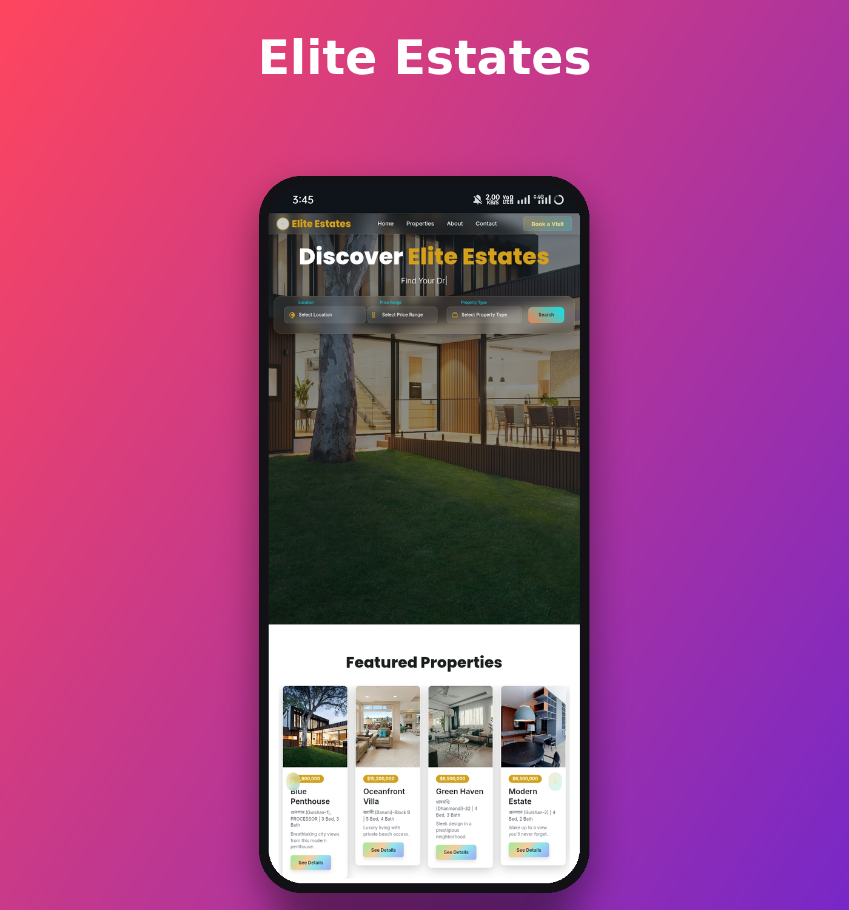
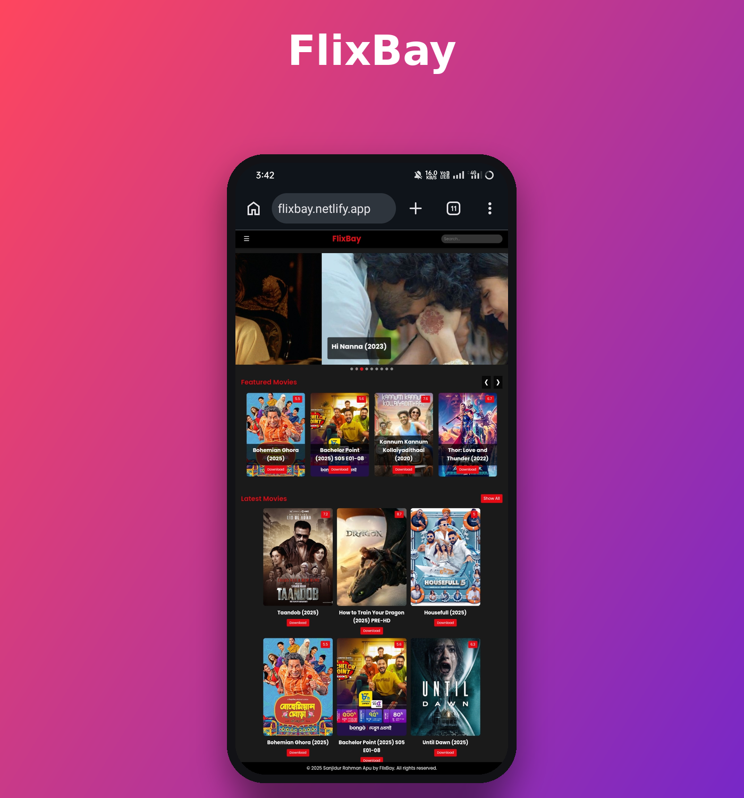

<!-- =============== HEADER =============== -->

  

  

  

  <b>Building digital experiences through code, creativity and innovation.</b>

  
  
  

---

## ✨ About Me

  I'm a developer passionate about creating Android applications, 
  modern websites and intelligent technology-driven solutions.

  🚀 Exploring new technologies and building real-world projects 
  📱 Focused on Android application development 
  🌐 Creating modern web experiences 
  🤖 Interested in Artificial Intelligence & Machine Learning 
  🎨 Passionate about UI, design and digital creativity

---

# 🚀 Featured Projects

<!-- =============== PROJECT 01 : PLANTX =============== -->

<h2 align="center">🌱 PlantX</h2>

  

  
  
  

  <b>AI-Powered Crop Disease Identification & Management System</b>

PlantX is an intelligent agriculture application designed to help users identify plant diseases, understand crop health and explore suitable fertilizer and spray management recommendations.

### ✨ Features

- 🌿 AI-based plant disease identification
- 📸 Leaf image scanning
- 🔬 Disease diagnosis
- 🌱 Crop health information
- 🧪 Fertilizer guidance
- 💧 Spray management assistance
- 🤖 AI-powered agricultural assistance
- 📱 User-friendly mobile interface

---

<!-- =============== PROJECT 02 : VIDFLIX =============== -->

<h2 align="center">🎬 VidFlix</h2>

  

  
  
  

  A modern Android application combining media downloading and private browsing in one experience.

### ✨ Features

- 📥 Media downloading experience
- 🎞️ Multiple quality options
- 🌐 Built-in private browser
- 🛡️ Privacy and DNS features
- 📱 Modern Android interface

### 🌐 Official Website

  

  
  
  

---

<!-- =============== PROJECT 03 : ELITE ESTATES =============== -->

<h2 align="center">🏡 Elite Estates</h2>

  

  
  
  

  A modern real estate website featuring elegant property showcases, 
  sophisticated layouts and a premium browsing experience.

### ✨ Features

- 🏠 Property showcase
- 💎 Premium real estate presentation
- 🔎 Property discovery experience
- 📐 Modern web layout
- 🌐 Responsive website design

  

---

<!-- =============== PROJECT 04 : FLIXBAY =============== -->

<h2 align="center">🍿 FlixBay</h2>

  

  
  
  

  A cinematic movie discovery experience with a modern dark interface, 
  featured titles and entertainment-focused visual design.

### ✨ Features

- 🎬 Movie discovery interface
- 🍿 Featured entertainment content
- 🌑 Cinematic dark UI
- 🎨 Modern visual experience
- 📱 Responsive browsing design

  

---

<!-- =============== TECH STACK =============== -->

<h2 align="center">🛠️ Tech Stack & Tools</h2>

  
  
  
  

  
  
  
  

  
  
  
  
  

  
  
  

---

<!-- =============== GITHUB STATS =============== -->

<h2 align="center">📊 GitHub Statistics</h2>

  

  

  

---

<!-- =============== CONNECT =============== -->

<h2 align="center">🌐 Connect & Explore</h2>

  

  

  

  <b>© Sanjidur Rahman Apu · Built with passion ❤️</b>

