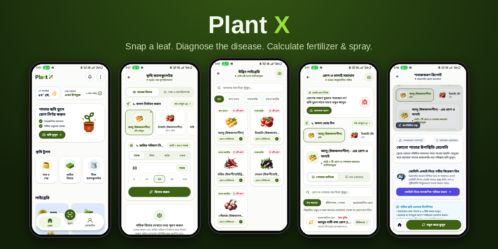
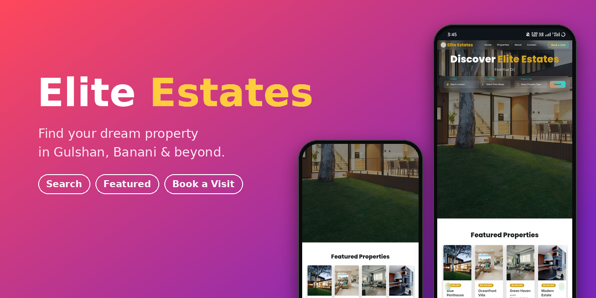
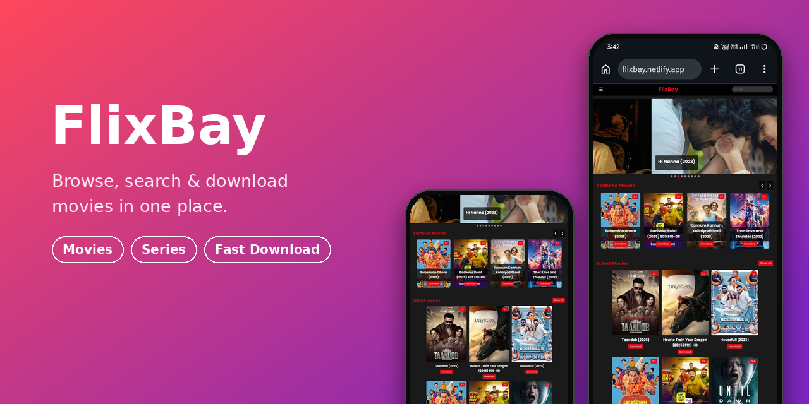

<!-- ================= HACKER DESIGN ================= -->

<p align="center">
  
</p>

<p align="center">
  
</p>

<p align="center">
  
</p>

<p align="center">
  
  
  
  
</p>

```bash
root@apu:~# cat about.txt
```

```yaml
name:       Sanjidur Rahman Apu
role:       [Android Dev, Web Dev, AI/ML Enthusiast]
mission:    Passionate about building modern applications,
            beautiful interfaces and intelligent digital solutions.
focus:
  - Android application development
  - Modern web experiences
  - AI & Machine Learning
  - UI/UX and creative design
status:     Always learning, experimenting and building
```


```bash
root@apu:~# ls ./projects
```

```text
[01] Al-Hidayah     -> Islamic knowledge app (Bangla)
[02] PlantX         -> AI crop disease detection
[03] VidFlix        -> Android video & music downloader
[04] Elite Estates  -> Real estate website
[05] FlixBay        -> Cinematic movie website
```

<br clear="right"/>

---

## `[01]` 🕌 Al-Hidayah

<p align="center">
  
</p>

<p align="center">
  
  
  
</p>

> A comprehensive Islamic knowledge application in Bangla. Designed to make authentic Islamic knowledge accessible through a clean, modern and user-friendly experience.

```text
▸ Hadith collections
▸ Islamic books
▸ Tafsir resources
▸ Ruqyah
▸ Bookmarking and saved content
▸ Search functionality
▸ Bengali Islamic content
▸ Modern Islamic user interface
```

---

## `[02]` 🌱 PlantX

<p align="center">
  
</p>

<p align="center">
  
  
  
</p>

> An AI-powered crop disease identification and management system. PlantX combines mobile technology and machine learning to help users identify plant diseases and explore crop management guidance.

```text
▸ AI-powered crop disease identification
▸ Leaf image scanning
▸ Disease detection and diagnosis
▸ Crop health information
▸ Fertilizer guidance
▸ Spray management suggestions
▸ AI agricultural assistance
▸ Mobile-first experience
```

---

## `[03]` 🎬 VidFlix

<p align="center">
  
</p>

<p align="center">
  
  
  
</p>

> A modern video & music downloader with integrated private browsing features. VidFlix is an Android media utility featuring media downloading, video quality selection, a built-in browser and privacy-oriented features in one application.

```text
▸ Video downloading
▸ Music & audio downloads
▸ Multiple video quality options
▸ Integrated web browser
▸ Privacy and DNS tools
▸ Modern Android UI
▸ APK update system
```

<p align="center">
  <a href="https://vidflixpremium.netlify.app/"></a>
  <a href="https://github.com/sanjidur-8267/VidFlix/releases"></a>
  <a href="https://github.com/sanjidur-8267/VidFlix"></a>
</p>

---

## `[04]` 🏡 Elite Estates

<p align="center">
  
</p>

<p align="center">
  
  
  
</p>

> A modern real estate website for discovering premium properties, with elegant layouts, property listings and premium visual presentation.

```text
▸ Property listings
▸ Property discovery
▸ Premium property showcase
▸ Modern real estate interface
▸ Responsive web design
▸ Elegant UI and layouts
```

<p align="center">
  <a href="https://tafs-estate.netlify.app/"></a>
</p>

---

## `[05]` 🍿 FlixBay

<p align="center">
  
</p>

<p align="center">
  
  
  
</p>

> A cinematic movie discovery website with a stylish dark interface, featuring movie collections, featured content and a modern entertainment interface.

```text
▸ Movie discovery
▸ Featured movies
▸ Browse entertainment content
▸ Cinematic dark interface
▸ Modern visual experience
▸ Responsive layout
```

<p align="center">
  <a href="https://flixbay.netlify.app/"></a>
</p>

---

```bash
root@apu:~# ./show_stack.sh
```

<p align="center">
  
</p>

<p align="center">
  
  
  
  
  
  
  
  
  
  
  
</p>

```bash
root@apu:~# ./github_stats --user sanjidur-8267
```

<p align="center">
  
  
</p>

<p align="center">
  
</p>

<p align="center">
  
</p>

```bash
root@apu:~# cat contact.txt
```

<p align="center">
  <a href="https://github.com/sanjidur-8267"></a>
  <a href="https://vidflixpremium.netlify.app/"></a>
  <a href="https://flixbay.netlify.app/"></a>
  <a href="https://tafs-estate.netlify.app/"></a>
</p>

<p align="center">
  
</p>

<p align="center">
  
</p>

<p align="center">
  <sub><code>© Sanjidur Rahman Apu</code></sub>
</p>
